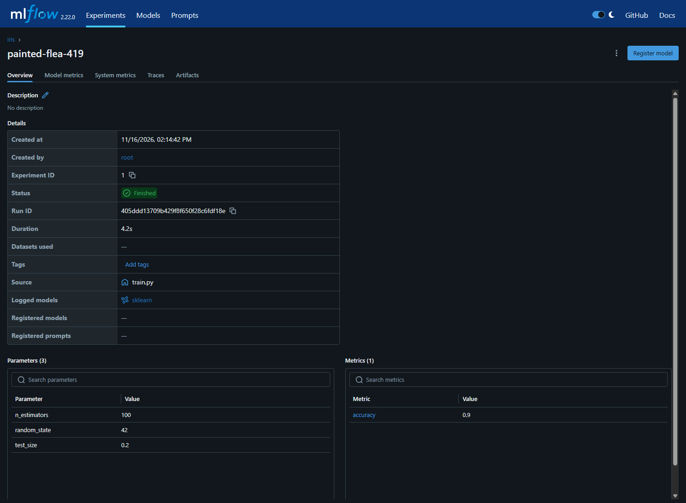
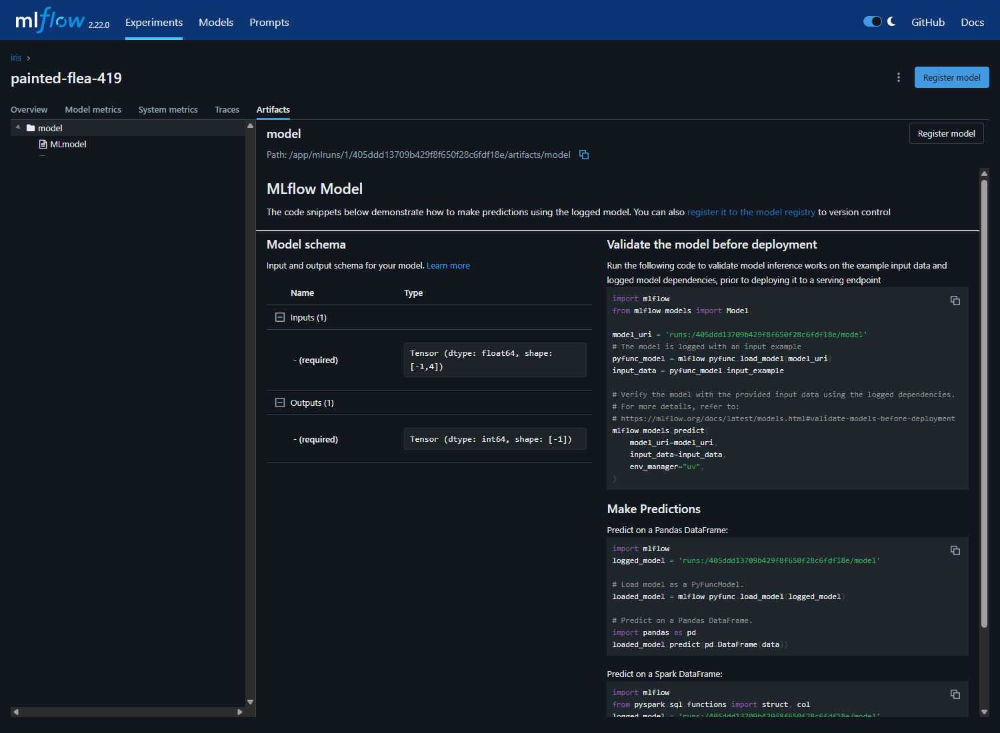
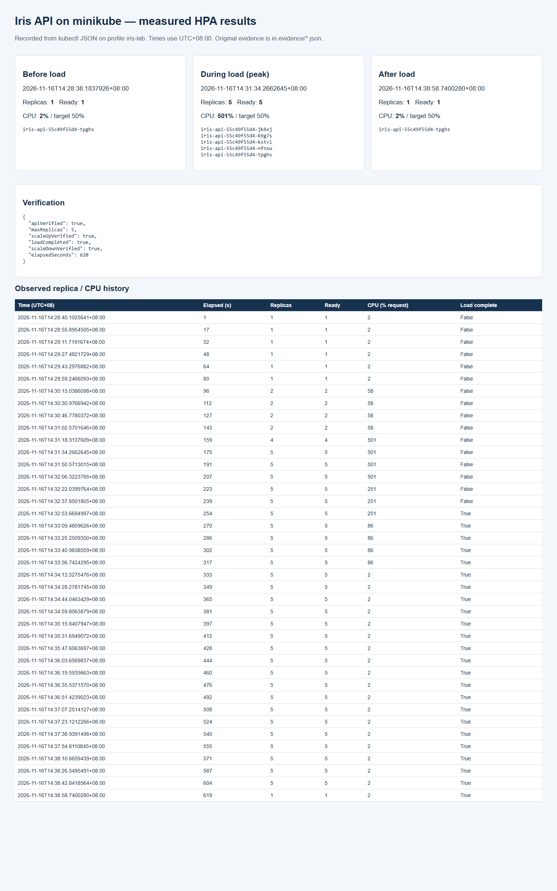

# Lab 1: Your First Model Service on Kubernetes

MLOps Foundations & Cloud Native AI，講義 p.49–52 作業。使用講義允許的 minikube 建立本機 Kubernetes 叢集。

## 作業繳交項目

| 要求 | 實作與證據 |
| --- | --- |
| Source Code | [train.py](train.py)、[app.py](app.py)、[Dockerfile](Dockerfile)、[套件清單](requirements-train.txt)、[操作腳本](lab.ps1) |
| YAML Configuration Files | [Deployment + Service](deployment.yaml)、[HorizontalPodAutoscaler](hpa.yaml)、[壓測 Job](loadtest.yaml) |
| MLflow Run Screenshots | [訓練 run](screenshots/01-mlflow-run.png)、[模型 artifacts](screenshots/02-mlflow-artifacts.png) |
| HPA Scaling Screenshot | [擴縮證據](screenshots/04-hpa-scaling.png) |
| 實測說明 | [REPORT.md](REPORT.md)、[原始驗證結果](evidence/verification-result.json)、[HPA 採樣紀錄](evidence/hpa-history.json)、[hey 壓測結果](evidence/hey-results.txt) |

實測結果：模型 accuracy **0.90**；API 範例回傳 `{"predictions":[0]}`；180 秒、50 個並行連線的壓測共 **7,732 次 HTTP 200**；副本數完成 **1 → 5 → 1**。完整擴縮觀察時間為 620 秒，包含啟動壓測與等待縮容。

### MLflow Run



### MLflow Model Artifacts



### HPA Scaling

下圖是實際 kubectl JSON 採樣資料整理成的觀測頁面截圖，包含負載前、擴容中、縮容後的時間、CPU 與 Pod 名稱；原始 JSON 和文字輸出均位於 [evidence/](evidence/)，可供核對。



## 下載與準備工具

先安裝並啟動 Docker Desktop，確認使用 Linux containers；以下指令在 Windows PowerShell 執行：

```powershell
git clone https://github.com/moonbirdyang/First_Model_Service_on_Kubernetes.git
cd First_Model_Service_on_Kubernetes
New-Item -ItemType Directory -Force tools | Out-Null
Invoke-WebRequest -UseBasicParsing -Uri 'https://github.com/kubernetes/minikube/releases/latest/download/minikube-windows-amd64.exe' -OutFile '.\tools\minikube.exe'
.\tools\minikube.exe version
```

以下所有操作均在下載後的專案根目錄執行；文中的絕對路徑為原始實測電腦範例，可換成自己的 clone 路徑。`tools/`、叢集憑證、本機快取與可重新產生的模型不納入版本控制。

本作業將 Iris 隨機森林模型包裝為 FastAPI，部署到本機 minikube，並以真實預測負載觀察 HPA 自動擴縮。

## 環境

- Docker Desktop，使用 Linux containers。
- tools/minikube.exe（專案專用）；腳本使用 minikube kubectl 取得相符版本，不依賴 Docker 附帶的 kubectl。
- Python 3.12 訓練及推論容器；不用修改 Windows 的 Python。
- profile：iris-lab；狀態位於 .minikube/，kubeconfig 位於 .kube/minikube-config。
- 每個 PowerShell 視窗先切換至本專案資料夾。

```powershell
cd C:\Users\User\python_code\First_Model_Service_on_Kubernetes
```

## 1. 環境檢查與訓練

```powershell
powershell -NoProfile -ExecutionPolicy Bypass -File .\lab.ps1 check
powershell -NoProfile -ExecutionPolicy Bypass -File .\lab.ps1 train
```

train.py 以 random_state=42、stratified 80/20 split 訓練 100 棵 RandomForest；MLflow 記錄參數、accuracy、模型與 signature。
產出 model.pkl、mlflow.db、mlruns/、training-result.json；實際 accuracy 請見 training-result.json。

## 2. 查看 MLflow

```powershell
powershell -NoProfile -ExecutionPolicy Bypass -File .\lab.ps1 mlflow
```

保持視窗執行，開啟 http://localhost:5000，選 iris experiment，查看 run 的 params、accuracy 與 model artifacts，截圖存入 screenshots/。
Ctrl+C 可停止 UI，紀錄仍保存。

## 3. 建立 minikube 並部署

```powershell
powershell -NoProfile -ExecutionPolicy Bypass -File .\lab.ps1 deploy
```

執行 minikube start（Docker driver，2 CPU、3072 MiB）、建立 iris-api:v1、minikube image load、套用 Deployment/Service。
接著啟用 metrics-server addon、套用 HPA：CPU 50%、最少 1 個、最多 5 個 Pod。
成功條件是 API Pod READY 1/1，metrics-server rollout 成功。

## 4. 測試 API

視窗 A 持續執行：

```powershell
powershell -NoProfile -ExecutionPolicy Bypass -File .\lab.ps1 forward
```

視窗 B 執行：

```powershell
powershell -NoProfile -ExecutionPolicy Bypass -File .\lab.ps1 test
```

預期 healthz 為 ok=true；輸入 [[5.1,3.5,1.4,0.2]] 回傳 predictions=[0]。
四個特徵依序為萼片長、萼片寬、花瓣長、花瓣寬，單位公分；類別 0/1/2 為 setosa/versicolor/virginica。
http://localhost:8080/docs 可用互動介面測試。請保存成功回應截圖。

## 5. 負載與 HPA

負載前先執行並保存 1 個 API Pod 的畫面：

```powershell
powershell -NoProfile -ExecutionPolicy Bypass -File .\lab.ps1 status
```

另開視窗監看：

```powershell
powershell -NoProfile -ExecutionPolicy Bypass -File .\lab.ps1 watch
```

啟動 180 秒、50 個並行連線的 hey POST 壓測：

```powershell
powershell -NoProfile -ExecutionPolicy Bypass -File .\lab.ps1 load
```

Job 首次先下載 Go image 並安裝 hey，完成後才開始負載。
流量在叢集內透過 Service 分配給各 Pod。
CPU request=100m，HPA 50% 約等於平均每 Pod 50m CPU，並非整台電腦 CPU 的 50%。
拍下 HPA 擴容、status 顯示多個 API Pod 的畫面；不要把 iris-load Pod 算成 API 副本。
副本數依負載而定，不保證一定達 5；負載停止後通常需等待約 5 分鐘穩定期才縮容。
load 可重跑，會先刪除舊壓測 Job。

## 手動 minikube 指令

每個新視窗先設定專案路徑及環境：

```powershell
cd C:\Users\User\python_code\First_Model_Service_on_Kubernetes
$env:MINIKUBE_HOME = "$PWD\.minikube"
$env:KUBECONFIG = "$PWD\.kube\minikube-config"
.\tools\minikube.exe -p iris-lab status
.\tools\minikube.exe -p iris-lab kubectl -- --kubeconfig $env:KUBECONFIG --context iris-lab get pods
.\tools\minikube.exe -p iris-lab kubectl -- --kubeconfig $env:KUBECONFIG --context iris-lab describe hpa iris-api
.\tools\minikube.exe -p iris-lab kubectl -- --kubeconfig $env:KUBECONFIG --context iris-lab logs job/iris-load
```

## 排錯

- Docker 沒有 Server：啟動 Docker Desktop，確認 Linux containers。
- HPA unknown：等 1–2 分鐘，執行 status；檢查 metrics-server logs、describe hpa。
- 未擴容：檢查 Job 是否仍在安裝 hey、POST 是否成功、CPU 是否超過目標。可提高 loadtest.yaml 的並行數或持續時間後重跑，報告應記錄實際參數。
- 8080/5000 被占用：停止舊 port-forward 或 MLflow UI，重試。
- 修改模型後：重新 train、deploy，再 rollout restart deployment/iris-api，因相同 image tag 不會自動重啟 Pod。
- 壓測時不要重套 deployment.yaml，以免 replicas: 1 干擾 HPA 觀察。

## 繳交

自動實測工具（會產生約 3 分鐘的負載，並繼續等候縮容，通常合計 8–12 分鐘）：

```powershell
powershell -NoProfile -ExecutionPolicy Bypass -File .\verify.ps1
python .\render_evidence.py
```

verify.ps1 會自動建立測試用 port-forward，結束後關閉；執行前請先停止其他占用 8080 的 port-forward。
原始資料存入 evidence/，REPORT.md 與 HTML 觀測頁由 render_evidence.py 讀取原始資料生成。
HTML 觀測頁的截圖用於整理測量，並非 kubectl 終端機畫面；原始 JSON 與文字輸出可供核對。

- [ ] GitHub repo 包含程式、requirements、Dockerfile、YAML、lab.ps1、README。
- [ ] screenshots/ 包含 MLflow run 參數、accuracy、model artifacts。
- [ ] API 成功預測截圖。
- [ ] HPA 負載前 1 個、壓測中多個、停止後縮回 1 個副本的截圖。
- [ ] 報告填入實測 accuracy、負載條件、最大副本數及擴縮觀察。
- [ ] 請勿上傳 .kube/、.minikube/、tools/ 等設定與憑證。模型可由 train.py 重現。

在 GitHub 建立空 repository 後，將下列網址換成自己的 repository，再執行：

```powershell
git init
git add .
git commit -m "Complete Iris model service on minikube"
git branch -M main
git remote add origin https://github.com/YOUR_ACCOUNT/First_Model_Service_on_Kubernetes.git
git push -u origin main
```

## 完成後釋放資源

設定上述 MINIKUBE_HOME 與 KUBECONFIG 後，可停止叢集（保留狀態）：

```powershell
.\tools\minikube.exe -p iris-lab stop
```

確定證據已保存且不再需要叢集時才刪除：

```powershell
.\tools\minikube.exe -p iris-lab delete
```

## 官方參考

- https://minikube.sigs.k8s.io/docs/start/
- https://minikube.sigs.k8s.io/docs/commands/kubectl/
- https://minikube.sigs.k8s.io/docs/handbook/config/
- https://kubernetes.io/docs/concepts/workloads/autoscaling/horizontal-pod-autoscale/
